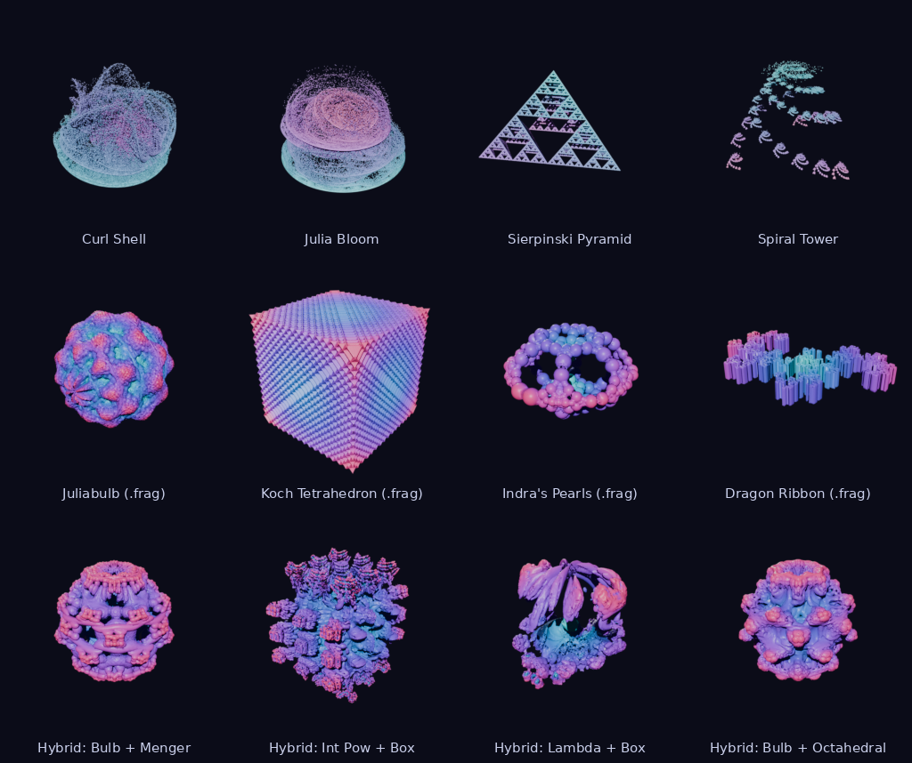

<p align="center">
  <picture>
    <source media="(prefers-color-scheme: dark)" srcset="branding/svg/iteron-logo-on-dark.svg">
    
  </picture>
</p>

<p align="center"><b>3D fractals, flames and fragments as real, editable Blender meshes.</b></p>

<p align="center"></p>

Iteron adds 37 fractal formulas to Blender as ordinary mesh objects, in seven families: Mandelbulbs and their
variants, Mandelboxes, sponges and cubes, kaleidoscopic IFS, hypercomplex sets, inversion limit sets, and hybrids of
them. You shape a fractal from one sidebar tab — ray-marched live in the viewport while its mesh rebuilds — then build
it at high resolution (up to 4096³). It also opens fractal flames (Fractalchemy's `.fa` and `.fa3d`, Apophysis's
`.flame`) as point clouds or solids, and Fragmentarium distance estimators (`.frag`, `.fafrag`) as meshes. Everything
renders in Cycles and EEVEE, exports with Blender's own exporters (colours included), animates, and takes modifiers,
materials and undo like any other mesh.

## Install

Iteron needs **Blender 4.2 or newer**; it is developed on Blender 5.x.

1. Download `iteron-x.y.z.zip` from the [releases](../../releases).
2. In Blender, open **Edit ▸ Preferences ▸ Get Extensions**, click **▾** (top right) and choose **Install from
   Disk…**, then pick the zip. You can also drag the zip onto Blender.

To build the zip yourself, run `python tools/build.py`; the zip is written to `dist/`.

## Use

* **Add** a fractal with **Shift+A ▸ Iteron Fractal ▸** a family ▸ a formula. The fractal appears at the 3D cursor
  and its preview builds a moment later. You can also use the **Iteron** tab in the 3D Viewport sidebar (**N**): with
  no fractal selected it shows a family picker and that family's formulas as a thumbnail gallery, with *Add
  Fractal*, *Add Flame* and *Open File…*. Or search for *Iteron* with **F3**.
* **Shape** it in the **Iteron** tab. Every slider rebuilds the preview while **Live** (the ▶ in the panel header)
  is on.
  * **Presets:** pick a built-in preset, save your own with **+**, delete yours with **−**, or reset everything
    with ↺.
  * **Julia:** escape-time formulas have a **Julia** section.
* **Region** sets what is sampled:
  * **Frame View** meshes only what the viewport is looking at, around its pivot and at its current zoom. Zoom in on
    a detail, press Frame View, then Build Final to get that detail at full resolution. ↺ goes back to the whole
    fractal.
  * **Auto-Fit**, **Center** and **Size** set the box by hand.
  * **Cut** slices the fractal open along X, Y or Z to show its inside. The cut face is closed, so the mesh stays
    solid.
* **Mesh** holds the build's quality settings. How each one trades detail for speed:
  * **Preview** is the live resolution.
  * **Surface Offset** is how far out the surface sits, in voxels of true distance (Iteron measures how much each
    formula's distance estimate underestimates and corrects for it). Lower shows finer detail; higher is cleaner and
    has fewer faces. Each formula starts at a sensible value.
  * **Refine** is how many Newton steps move every vertex exactly onto the fractal's surface, so ridges and grooves
    come out crisp instead of melted. Previews use at most one step.
  * **Shading:** *Field Normals* (the default) takes the normals from the fractal itself, so the shading shows
    detail finer than the faces.
  * **Final** is the Build Final resolution, with an estimate of the face count and memory.
  * **Simplify** lets Build Final merge flat areas into larger faces, within a fraction of a voxel, while intricate
    areas keep every face. The mesh stays closed and manifold.
  * **Apply as Plain Mesh** stops rebuilding and keeps the mesh as it is, for sculpting or editing.
  * **Output** *Volume* fills the mesh as a volume (a Geometry Nodes *Mesh to Volume* modifier with a Principled
    Volume material) for fog-like renders; *Density* and *Voxel Size* set it.
  * **Bake Animation** builds the Final mesh of every frame in the scene's range (see *Animation* below).
* **Color** chooses what drives the colour ramp (*Orbit Trap*, *Iterations*, *Radius*, *Solid*) and shows the
  ramp itself. The ramp is the object's material: editing it here or in the Shader Editor is the same thing.

### The live preview

While a fractal's mesh is out of date (you are dragging a slider, or it is rebuilding) the viewport shows it
**ray-marched** on the GPU, in place, with correct depth among other objects and coloured by the same ramp. The row
under the formula picks the mode: **Auto** (ray-marched only while the mesh is stale), **Ray-march** (always: the
fastest way to explore — only Build Final makes a mesh) or **Mesh** (never).

<p align="center"></p>

### Hybrids

**Hybrid** (Shift+A ▸ Iteron Fractal ▸ Hybrids) runs one formula's step and then another's every iteration,
Mandelbulb3D style: pick the two formulas (any escape-time or folding formula) and how many steps of each. Each part
keeps its own parameters — a Mandelbulb's power is the same whether it is used alone or in a hybrid — and the
presets (*Bulb + Box*, *ABox + Bulb*, *Bulb + Menger*, …) pick both parts at once.

### Flames

**Shift+A ▸ Iteron Flame** adds one of Iteron's fractal flames; **File ▸ Import ▸ Fractals** (or the sidebar's
*Open File…*) opens your own:

* **`.fa`** (Fractalchemy) and **`.flame`** (Apophysis, flam3, JWildfire's flam3 export) — every flame in the file,
  side by side, or the one you pick by number.
* **`.fa3d`** — the flame with its 3D camera, lights, world colour, surface and mesh settings.

A flame is iterated with the chaos game on the CPU (97 variations, the 3D ones included; any variation Iteron lacks
is named in the panel and skipped). **Output** *Points* makes a point cloud rendered as tiny spheres (a Geometry Nodes
modifier; *Point Size* sets them), *Solid* a closed mesh around the orbit's dense regions (*Density Threshold*,
*Smoothing*). Points are coloured from the flame's palette.

### Fragments

**File ▸ Import ▸ Fractals** also opens Fragmentarium fragments (`.frag`, and Fractalchemy's `.fafrag`) that
define a 3D distance estimator, `float DE(vec3 p)`:

* The **annotated uniforms** become the fragment's sliders (`obj.iteron.fragment.params["Power"]`, keyframeable),
  grouped by their `#group`; the **`#preset`** blocks are its presets; the preset's camera can become a Blender
  camera.
* FragM's own include files can't ship with Iteron (they are GPL), so Iteron brings **MIT stand-ins** for the ray
  tracers, `MathUtils.frag`, `Triplex.frag` and `Primitives.frag`. Any other include is looked for beside the file
  and in the **Include Folders** set in the add-on's preferences (point them at Fractalchemy's or FragM's library).
* The source is kept in the `.blend` as a Text datablock (your own includes inlined), so the file opens anywhere.
  Edit it in the Text Editor and rebuild; **Reload from Disk** reads the file again.
* Fragments are GLSL, so they build on the **GPU only**. Textures and buffer shaders aren't supported; the panel
  says what a fragment needs that Iteron lacks. The colours come from the fragment's orbit trap.

### Animation

Every parameter can be keyframed; while playing or scrubbing, a fractal whose parameters changed rebuilds its
preview. For renders, **Bake Animation** (in the Mesh section) builds the Final mesh of every frame of the scene's
range and keeps them: the object swaps meshes on frame change — also while rendering, and on render farms — instead
of rebuilding. **Clear Bake** goes back to live rebuilding.

The fractal is a normal mesh object, so all of Blender's tools apply:

* **Modifiers** survive rebuilds.
* **Undo, `.blend` files and linked duplicates** work. Opening a file never recomputes anything.
* **Exporting:** for glTF, set *Data ▸ Mesh ▸ Vertex Color* to **Active** to include the colours. PLY and USD carry
  the `Col` attribute too.

### Detail, speed and face counts

Fractal surfaces grow faster than the square of the resolution (faces ≈ resolution^2.5), so detail costs faces. To
make the most of each one:

* Use **Frame View** for close-ups. A detail that fills the screen gets the whole resolution budget.
* Raise **Final** for whole-object renders, and keep **Simplify** on.
* Lower **Surface Offset** for crisper fine detail, or raise it for a cleaner, lighter mesh.

Builds sample only the parts of space the surface passes through, one block at a time, so memory follows the surface
rather than the volume: a coarse pass finds the blocks near the fractal, and large builds probe every such block on
a coarse lattice and skip the ones no surface can reach. **Final** goes up to 4096 (the preference *Resolution
Limit* guards it, 1024 by default). At 2048 and beyond, use it with **Frame View** or for sparse shapes — a whole
Mandelbulb at 4096³ would be hundreds of millions of faces.

The field is sampled on the **GPU** through Blender's own `gpu` module when it can be, and on the CPU with numpy
otherwise. The CPU is slower but works everywhere, including `blender -b`. You can choose either in the add-on's
preferences.

### Command line

`core`, `jobs`, `flames` and `fragments` never import Blender, so the same builds run from a shell and write PLY
or OBJ (with vertex colours and normals):

```bash
python -m iteron.cli formulas                                   # formulas, parameters and presets
python -m iteron.cli mesh mandelbulb -s power=9 -r 320 -o bulb.ply          # numpy; --gpu uses moderngl
python -m iteron.cli mesh hybrid --preset "Bulb + Menger" -o hybrid.obj
python -m iteron.cli fragment "3D - Juliabulb.frag" -r 256 -o julia.ply     # needs moderngl (OpenGL 3.3)
python -m iteron.cli flame my_flames.fa -n 5000000 -o flame.ply            # points; --solid for a mesh
python -m iteron.cli flame pack.flame --index 3 --solid -r 256 -o f.obj     # Apophysis .flame files too
```

Run it from the repository's root with numpy installed (and moderngl for `--gpu` and fragments).

### Scripting

```python
import bpy
bpy.ops.iteron.add_fractal(formula="mandelbulb")
obj = bpy.context.active_object
obj.iteron.f_mandelbulb.power = 6.0          # each formula's parameters live in obj.iteron.f_<formula id>
obj.iteron.final_resolution = 320
bpy.ops.iteron.build_final()                 # from a script (or blender -b) this builds synchronously
```

Formula ids are the names in lower case with underscores (`mandelbulb`, `menger_sponge`, `folding_int_pow`, …;
`aboxmod1` for ABoxMod1). In background mode, changing a parameter doesn't start a build; call
`bpy.ops.iteron.rebuild()` or `bpy.ops.iteron.build_final()`.

## Formulas

| Family | Formula | Presets |
|---|---|---|
| Bulbs | Mandelbulb | Classic, Power 4, Power 3, Juliabulb |
| Bulbs | Folding Int Pow | Default, Power 2, Flattened, Julia |
| Bulbs | Lambdabulb | Default, Power 2, Spiral |
| Bulbs | Cosine Mandelbulb | Default, Power 8, Power 3, Julia |
| Bulbs | Mandelbar Bulb | Default, Power 2, Power 5, Julia |
| Bulbs | Burning Ship Bulb | Default, Power 2, Power 5, Julia |
| Bulbs | Bristorbrot | Default, Julia, Deep |
| Bulbs | Polynomial Bulb | Default, Eight and Three, Negative, Julia |
| Boxes | Mandelbox | Classic, Open, Sculpted, Amazing Box |
| Boxes | Amazing Surf | Default, Flat, Waves |
| Boxes | ABoxMod1 | Default, Negative, Turned, Offset |
| Boxes | Mandelbox 4D | Default, Sliced Deep, Negative, Shifted |
| Boxes | Vary Scale Box | Default, Gentle, Shrinking, Strong |
| Boxes | Tetra Box | Default, Negative, Tight, Julia |
| Sponges & Cubes | Menger Sponge | Level 4, Level 2, Level 5, Stretched |
| Sponges & Cubes | Mosely Snowflake | Default, Keep Centre, Lace |
| Sponges & Cubes | Jerusalem Cube | Default, Level 2, Chunky, Airy |
| Sponges & Cubes | Cantor Dust | Level 4, Level 2, Fat, Stretched |
| Sponges & Cubes | Vicsek Cube | Cross, Corners, Cross Level 2 |
| Sponges & Cubes | Koch Cube | Default, Level 2, Small Children, Floating |
| Sponges & Cubes | Twisted Menger | Default, Spun, Skewed, Open |
| Sponges & Cubes | Gyroid Foam | Default, Coarse, Lace, Dense |
| Kaleidoscopic IFS | Sierpinski Tetrahedron | Default, Sparse, Skewed |
| Kaleidoscopic IFS | Octahedral KIFS | Default, Truncated, Star, Twisted |
| Kaleidoscopic IFS | Koch Tetrahedron | Default, Level 2, Stretched |
| Kaleidoscopic IFS | Icosahedral KIFS | Flake, Loose, Twisted, Dense |
| Kaleidoscopic IFS | Dodecahedral KIFS | Flake, Overlapping, Twisted, Loose |
| Kaleidoscopic IFS | Sierpinski Square Pyramid | Default, Sparse, Level 3 |
| Hypercomplex | Quaternion Julia | Default, Coral, Dendrite |
| Hypercomplex | Quaternion Mandelbrot | Default, Sliced, Deep |
| Hypercomplex | Cubic Quaternion Julia | Default, Spiky, Lobes |
| Hypercomplex | Tetrabrot | Default, Sliced, Deep |
| Hypercomplex | Bicomplex Julia | Default, Dendrite, Rabbit |
| Inversions | Apollonian Packing | Default, Loose, Tight, Large Chunk |
| Inversions | Pseudo Kleinian | Default, Open, Shifted, Chunky |
| Inversions | Sphere Inversion IFS | Default, Threads, Lattice, Swollen |
| Hybrids | Hybrid | Bulb + Box, ABox + Bulb, Bulb + Menger, Bulb + Octahedral, Int Pow + Box, Lambda + Box |

Flames: *Sierpinski Pyramid*, *Julia Bloom*, *Curl Shell*, *Spiral Tower* (Shift+A ▸ Iteron Flame), and any `.fa` /
`.fa3d` file.

Where each formula's mathematics comes from is in [THIRD_PARTY.md](THIRD_PARTY.md).

## Development

```
iteron/            the extension (what the zip contains)
  core/            formulas' machinery, numpy evaluation, GLSL tracing, blocks, surface nets, refinement,
                   simplification, the ray-march shader — never imports bpy
  formulas/        small files of @formula functions by family (and variants); hybrid.py composes them
  flames/          the flame model, variations, chaos game, density meshing, .fa / .fa3d / .flame readers
  fragments/       the .frag preprocessor, GLSL compatibility, Iteron's MIT include shims (bpy-free)
  gpu_eval/        the GPU sampler and the live preview (Blender's gpu module)
  bridge/          Blender data: generated properties, kinds (formula / flame / fragment), mesh writing,
                   material, colours, staleness, animation and baking, volume output
  jobs/            the build pipelines (bpy-free) and the scheduler that runs them between UI events
  ops/  ui/        operators (add, build, presets, import, bake …), the sidebar panel, the Add menus, the overlay
  cli/             python -m iteron.cli: builds without Blender, PLY / OBJ writers, a moderngl sampler
  thumbnails/      the formula gallery (tools/render_thumbnails.py)
tests/core/        pytest, no Blender: formulas, hybrids, surface nets, GLSL ↔ numpy parity (moderngl), flames
                   (and their variations against Fractalchemy's), fragments, the command line
tests/blender/     pytest inside Blender: the add-on end to end, scheduler, GPU sampler, preview, UI, flames,
                   fragments, hybrids, animation
tests/run_tests.sh every check from fresh environments, with a summary (see below)
tools/             build.py, check_install.py, check_catalogue.py, lint.py, run_blender_tests.py,
                   render_thumbnails.py, compose_gallery.py, render_showcase.py
branding/          the logo and icons (and their generator)
```

**Adding a formula** means writing one function. Its parameters, Blender properties, sidebar widgets, GLSL shader,
CPU fallback and presets are all generated from this:

```python
@formula("Mandelbulb", family="Bulbs", kind=ESCAPE, distance=LOG, bounds=1.4,
         params=(Float("power", 8.0, min=2.0, max=16.0),), presets={"Power 4": {"power": 4.0}})
def mandelbulb(z, dr, c, p):
    r = ops.max(ops.length(z), TINY)
    dr = ops.pow(r, p.power - 1.0) * p.power * dr + 1.0
    return triplex_power(z, p.power) + c, dr
```

Formulas use the GLSL-named functions in `iteron.core.ops`. Run with numpy arrays they compute (the CPU path); run
with symbolic values they are traced into GLSL (the GPU path). Use `ops.select` for choices that depend on the point,
and `ops.loop` for runtime-bounded loops. The parity tests then check that both paths agree.

**Tests**

```bash
tests/run_tests.sh                                    # everything, from fresh virtual environments (below)
python -m pytest tests/core                           # numpy + pytest (+ moderngl for the GPU parity tests)
python -m pip install bpy && python -m pytest tests   # the whole suite against the bpy module (Python 3.11)
blender -b --factory-startup --python tools/run_blender_tests.py    # or inside a real Blender
```

`tests/run_tests.sh` creates fresh environments (with `uv` when it is installed, `venv` + `pip` otherwise), installs
the dependencies (numpy, pytest, pyflakes, moderngl; `bpy` 4.2.0 and 5.0.1 on Python 3.11), then runs the lint, the
file-size and licence-header rules, the formula catalogue (thumbnails, this README's table, credits), the bpy-free
import check, the core tests, the command line (a formula and a `.flame` file), the whole suite under each Blender
version, manifest validation, the zip build and an install check per version. It prints one line
per check — `EXPECTED` or `MISMATCH` — and exits non-zero on any mismatch. Its environment variables (a Python 3.11
to use, a wheel folder, which Blender versions) are listed at the top of the script.

## License

MIT — see [LICENSE](LICENSE). Copyright (c) 2026 Stan Ragets.
