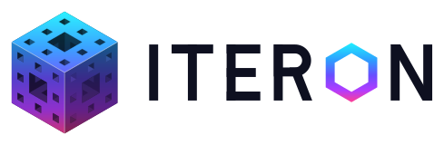
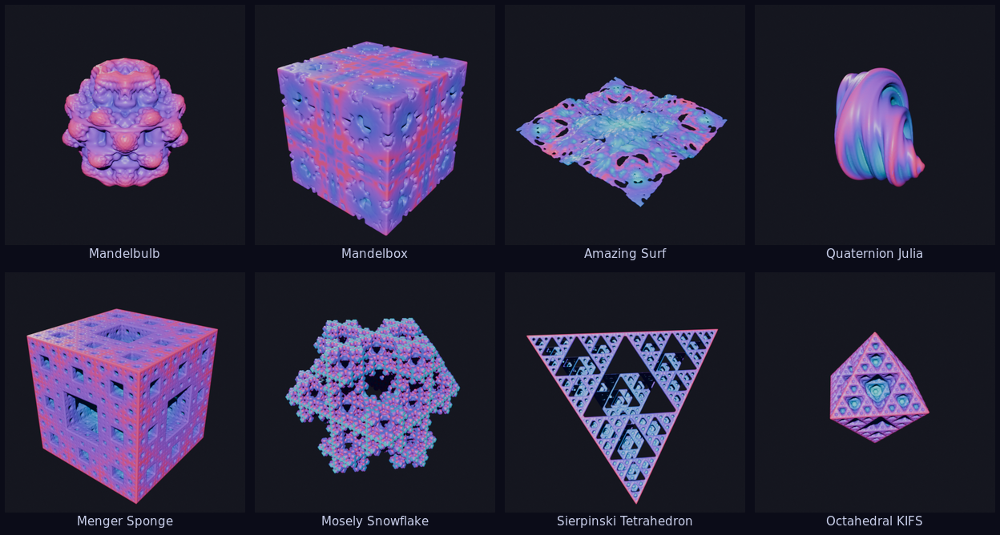

<p align="center">
  <picture>
    <source media="(prefers-color-scheme: dark)" srcset="branding/svg/iteron-logo-on-dark.svg">
    
  </picture>
</p>

<p align="center"><b>3D fractals as real, editable Blender meshes.</b></p>

<p align="center"></p>

Iteron adds Mandelbulbs, Mandelboxes, Menger sponges, kaleidoscopic IFS and quaternion Julia sets to Blender as
ordinary mesh objects. You shape a fractal from one sidebar tab while a preview rebuilds live, then build it at high
resolution. It renders in Cycles and EEVEE, exports with Blender's own exporters (colours included), and takes
modifiers, materials and undo like any other mesh.

## Install

Iteron needs **Blender 4.2 or newer**; it is developed on Blender 5.x.

1. Download `iteron-x.y.z.zip` from the [releases](../../releases).
2. In Blender, open **Edit ▸ Preferences ▸ Get Extensions**, click **▾** (top right) and choose **Install from
   Disk…**, then pick the zip. You can also drag the zip onto Blender.

To build the zip yourself, run `python tools/build.py`; the zip is written to `dist/`.

## Use

* **Add** a fractal with **Shift+A ▸ Iteron Fractal ▸** *Mandelbulb*, *Mandelbox*, … The fractal appears at the 3D
  cursor and its preview builds a moment later. You can also add one from the **Iteron** tab in the 3D Viewport
  sidebar (**N**), or search for *Iteron* with **F3**.
* **Shape** it in the **Iteron** tab. Every slider rebuilds the preview while **Live** (the ▶ in the panel header)
  is on. Pick a **Preset**, or reset the parameters with ↺. Escape-time formulas have a **Julia** section.
* **Region** sets what is sampled. *Auto-Fit* shrinks the box to the fractal; turn it off and set *Center* / *Size* to
  mesh a detail at high resolution.
* **Mesh** holds the preview resolution, the *Surface Offset* (0.5 voxel closes most fractals), **Build Final** at
  the final resolution (press Esc to cancel) and **Apply as Plain Mesh** (stop rebuilding and keep the mesh, e.g. to
  sculpt it).
* **Color** chooses what drives the colour ramp (*Orbit Trap*, *Iterations*, *Radius*, *Solid*) and shows the
  ramp itself. The ramp is the object's material: editing it here or in the Shader Editor is the same thing.

The fractal is a normal mesh object, so all of Blender's tools apply:

* **Modifiers** (Decimate, Smooth, Subdivision, Solidify) survive rebuilds.
* **Undo, `.blend` files and linked duplicates** work. Opening a file never recomputes anything.
* **Exporting:** for glTF, set *Data ▸ Mesh ▸ Vertex Color* to **Active** to include the colours. PLY and USD carry
  the `Col` attribute too.
* **Keyframes:** parameters can be keyframed. Rebuilding per frame comes in a later phase.

### Speed

The field is sampled on the **GPU** through Blender's own `gpu` module when it can be, and on the CPU with numpy
otherwise. The CPU is slower but works everywhere, including `blender -b`. You can choose either in the add-on's
preferences. Memory grows with the cube of the resolution; the Mesh section shows an estimate before Build Final,
and the preferences cap the final resolution (512 by default).

### Scripting

```python
import bpy
bpy.ops.iteron.add_fractal(formula="mandelbulb")
obj = bpy.context.active_object
obj.iteron.f_mandelbulb.power = 6.0          # each formula's parameters live in obj.iteron.f_<formula id>
obj.iteron.final_resolution = 320
bpy.ops.iteron.build_final()                 # from a script (or blender -b) this builds synchronously
```

Formula ids are `mandelbulb`, `mandelbox`, `amazing_surf`, `menger_sponge`, `mosely_snowflake`,
`sierpinski_tetrahedron`, `octahedral_kifs` and `quaternion_julia`. In background mode, changing a parameter doesn't
start a build; call `bpy.ops.iteron.rebuild()` or `bpy.ops.iteron.build_final()`.

## Formulas

| Family | Formula | Presets |
|---|---|---|
| Bulbs | Mandelbulb | Classic, Power 4, Power 3, Juliabulb |
| Boxes | Mandelbox | Classic, Open, Sculpted, Amazing Box |
| Boxes | Amazing Surf | Default, Flat, Waves |
| Sponges | Menger Sponge | Level 4, Level 2, Level 5, Stretched |
| Sponges | Mosely Snowflake | Default, Keep Centre, Lace |
| Kaleidoscopic IFS | Sierpinski Tetrahedron | Default, Sparse, Skewed |
| Kaleidoscopic IFS | Octahedral KIFS | Default, Truncated, Star, Twisted |
| Quaternion | Quaternion Julia | Default, Coral, Dendrite |

Where each formula's mathematics comes from is in [THIRD_PARTY.md](THIRD_PARTY.md).

## Development

```
iteron/            the extension (what the zip contains)
  core/            formulas' machinery, numpy evaluation, GLSL tracing, grids, surface nets — never imports bpy
  formulas/        one small file per family of @formula functions
  gpu_eval/        the GPU sampler (Blender's gpu module)
  bridge/          Blender data: generated properties, mesh writing, material, colours, staleness
  jobs/            the build pipeline (bpy-free) and the scheduler that runs it between UI events
  ops/  ui/        operators, the sidebar panel, the Add menu
tests/core/        pytest, no Blender: formulas, surface nets, GLSL ↔ numpy parity (moderngl)
tests/blender/     pytest inside Blender: the add-on end to end, the scheduler, the GPU sampler, the UI
tools/             build.py, check_install.py, run_blender_tests.py, render_gallery.py
branding/          the logo and icons (and their generator)
```

**Adding a formula** means writing one function. Its parameters, Blender properties, sidebar widgets, GLSL shader,
CPU fallback and presets are all generated from this:

```python
@formula("Mandelbulb", family="Bulbs", kind=ESCAPE, distance=LOG, bounds=1.4,
         params=(Float("power", 8.0, min=2.0, max=16.0),), presets={"Power 4": {"power": 4.0}})
def mandelbulb(z, dr, c, p):
    r = ops.max(ops.length(z), TINY)
    dr = ops.pow(r, p.power - 1.0) * p.power * dr + 1.0
    return triplex_power(z, p.power) + c, dr
```

Formulas use the GLSL-named functions in `iteron.core.ops`. Run with numpy arrays they compute (the CPU path); run
with symbolic values they are traced into GLSL (the GPU path). Use `ops.select` for choices that depend on the point,
and `ops.loop` for runtime-bounded loops. The parity tests then check that both paths agree.

**Tests**

```bash
python -m pytest tests/core                           # numpy + pytest (+ moderngl for the GPU parity tests)
python -m pip install bpy && python -m pytest tests   # the whole suite against the bpy module (Python 3.11)
blender -b --factory-startup --python tools/run_blender_tests.py    # or inside a real Blender
```

## License

MIT — see [LICENSE](LICENSE). Copyright (c) 2026 Stan Ragets.
