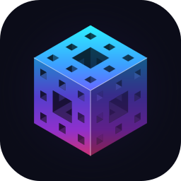

# Iteron branding

<p align="center">
  
</p>

The Iteron mark is a **level-2 Menger sponge** in isometric view: a real 3D fractal rendered as flat vector geometry.
The tunnels show their true inner walls. A cyan → blue → violet → magenta sweep runs from the top point to the bottom
point, and each face is lit by its orientation. The wordmark is drawn from geometry rather than set in a font. Its
**O is the cube's hexagonal silhouette**, painted in the same sweep, which ties the name to the mark.

Everything here is generated by `source/build.py`. To change a colour or proportion, edit `source/` and rebuild;
don't edit the outputs by hand.

## Files

| File | Use |
|---|---|
| `svg/iteron-mark.svg` | The mark on its own, transparent. Master artwork for anything 48 px and up. |
| `svg/iteron-mark-small.svg` | A level-1 sponge for **16–48 px** (favicons, UI icons), where level 2's small holes turn to mush. |
| `svg/iteron-logo-on-dark.svg` | Mark + wordmark with light letters, for dark backgrounds. |
| `svg/iteron-logo-on-light.svg` | Mark + wordmark with dark letters, for light backgrounds. |
| `svg/iteron-app-icon.svg` | The mark on a rounded night-blue tile: GitHub avatar, org icon, launchers. |
| `svg/iteron-social-preview.svg` | 1280 × 640 card with mark, wordmark and tagline. |
| `png/iteron-mark-{64…1024}.png` | Raster mark, transparent. |
| `png/iteron-mark-small-{16,24,32,48}.png` | Raster small mark, transparent. |
| `png/iteron-logo-on-{dark,light}-{80,160,320}.png` | Raster logos, heights in px. |
| `png/iteron-app-icon-{180,256,512,1024}.png` | Raster app icon. |
| `png/iteron-social-preview.png` | Upload under **GitHub ▸ Settings ▸ General ▸ Social preview**. |
| `png/favicon.ico` | 16 / 32 / 48 px, for a project site. |
| `addon/iteron_icon.png` | 64 px small mark: the add-on's UI icon (panel header, Add-menu entry). |
| `addon/iteron_logo.png` | 256 px mark: the quick-start panel in the Iteron sidebar tab. |

### On GitHub

Paste this into a README to show the logo that matches the reader's theme:

```html
<p align="center">
  <picture>
    <source media="(prefers-color-scheme: dark)" srcset="branding/svg/iteron-logo-on-dark.svg">
    
  </picture>
</p>
```

The social preview can't be set from a file in the repository; upload `png/iteron-social-preview.png` once in the
repository settings.

### Inside the add-on

The extension build copies `addon/*.png` into `iteron/icons/`, so `branding/` stays the single source. The add-on loads
them with `bpy.utils.previews` and uses them through `icon_value`:
* `iteron_icon` goes in the sidebar panel header and on the `Shift+A ▸ Iteron Fractal` entry.
* `iteron_logo` goes in the quick-start panel (`template_icon`).

Blender's sidebar tab label itself can only be text.

## Colours

| Role | Hex |
|---|---|
| Sweep 1 — cyan (top) | `#1FF0FF` |
| Sweep 2 — azure | `#2F9BFF` |
| Sweep 3 — indigo | `#6A4DFF` |
| Sweep 4 — violet | `#B23CFF` |
| Sweep 5 — magenta (bottom) | `#FF3F93` |
| Ink on light | `#0E1020` |
| Ink on dark | `#F4F6FF` |
| Night (tiles, cards) | `#0B0C18` |
| Muted text on night | `#9AA3C7` |

Face lighting: the top face is the sweep brightened 6 %, the left face 80 %, the right face 54 %. Tunnel walls are
darkened a further 62 % / 40 % by depth. All of this lives in `source/palette.py`.

## Usage

* **Clear space**: keep at least a quarter of the mark's height empty around the logo.
* **Minimum sizes**: the level-2 mark is 48 px; below that use the small mark. The horizontal logo is 40 px tall.
* Use the **on-dark** logo on dark backgrounds and the **on-light** logo on light ones. Don't recolour the mark, put it
  on busy imagery, add effects (shadows, outlines, bevels), stretch it, or rotate it. Its isometric angle is part of it.
* The wordmark is always **ITERON** in capitals with the hexagonal O. In running text the name is written *Iteron*.
* "for Blender" describes compatibility. Don't use the Blender logo in Iteron artwork.

## Rebuilding

```bash
cd branding/source
python -m venv .venv && . .venv/bin/activate     # optional
pip install -r requirements.txt                  # cairosvg needs the system cairo library
python build.py
```

`build.py` needs DejaVu Sans (installed on most Linux systems) only for the social card's tagline, which is converted
to paths so the SVG embeds no font.

| Source | What it defines |
|---|---|
| `palette.py` | Every colour and the lighting factors. |
| `menger.py` | The sponge, isometric projection, exact visibility on the triangular lattice, and region outlines. |
| `mark.py` | The mark as SVG: gradients, regions and the edge highlight. |
| `wordmark.py` | The ITERON letterforms as geometry. |
| `tagline.py` | Short text set as paths (social card). |
| `compose.py` | The lock-ups: horizontal logo, app icon and social card. |
| `build.py` | Writes every file listed above. |

## Licence

The Iteron logo and these sources are © 2026 Stan Ragets under the MIT licence, like the rest of the project. The
tagline's glyph outlines come from DejaVu Sans (Bitstream Vera licence, which permits this use).
